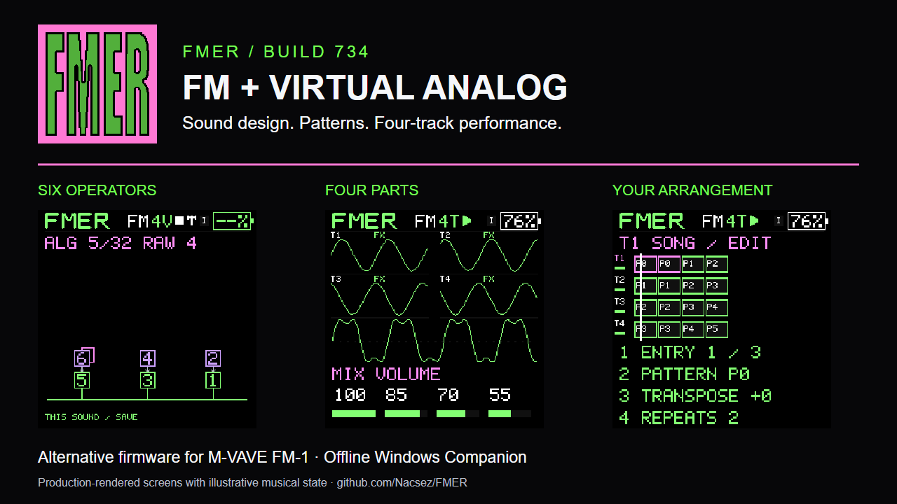
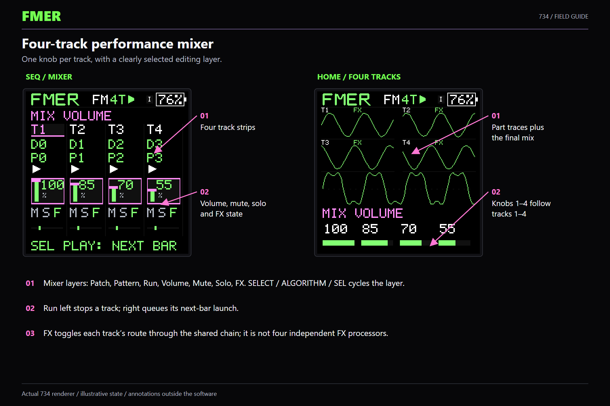
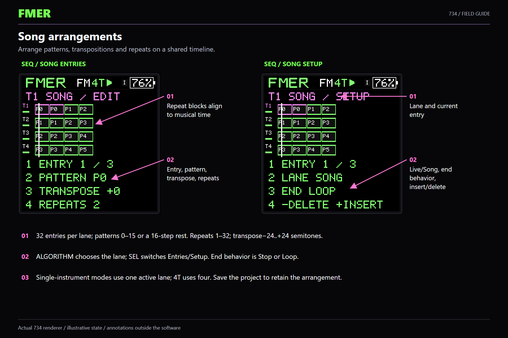
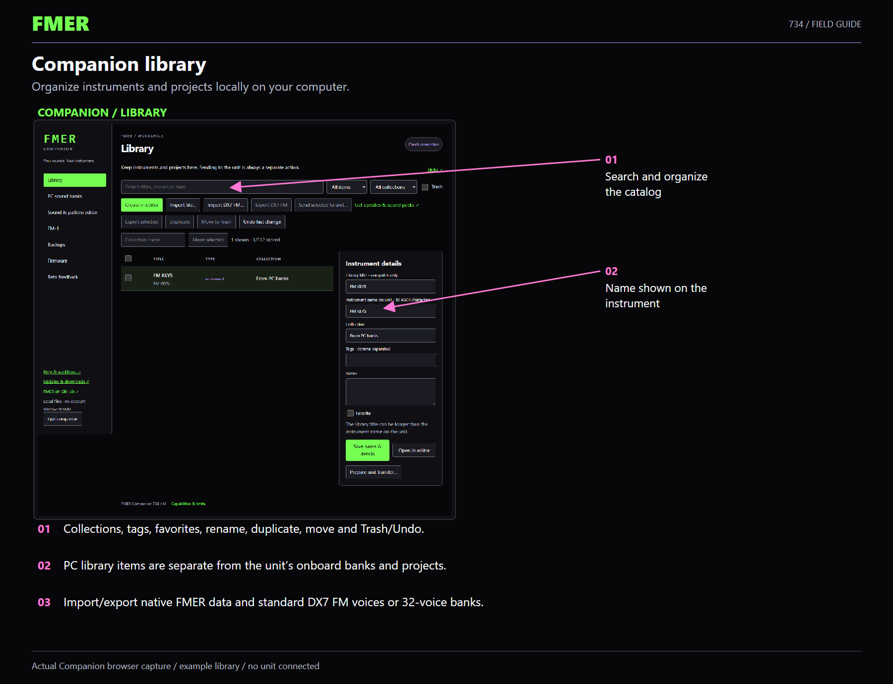

# FMER

**Six-operator FM. Virtual Analog. Four-track performance.**

FMER is alternative firmware for the M-VAVE FM-1. Design sounds, record patterns,
arrange songs and perform on the instrument. FMER Companion keeps your instruments,
projects and backups organized locally, with a guided firmware installer and an
illustrated offline handbook.

**Current firmware: 734-r2. Companion candidate: 734 r5.** Pre-1.0, using the same numbered builds throughout testing.
Read the [release status and test scope](docs/release/RELEASE_READINESS.md) for context.

## Start here

- [Downloads and release notes](https://github.com/Nacsez/FMER/releases):
  Companion for Windows 10/11 x64, firmware-only `.fwsc`, default-sound catalog, source, PDFs and press pack.
- [Install FMER](docs/release/INSTALLATION.md): extract the entire Companion ZIP,
  launch `FMER Companion.exe`, connect one unit and follow Firmware.
- [Visual feature tour](docs/release/FEATURES.md): annotated screens for every major function.
- [Feature overview PDF](docs/release/media/FMER-734-Feature-Overview.pdf),
  [full visual manual](docs/release/media/FMER-734-Visual-Guide.pdf) and
  [one-page shortcuts](docs/release/media/FMER-734-Shortcuts.pdf).
- [Feedback and bug reports](https://github.com/Nacsez/FMER/issues/new/choose).

No Python installation, cloud account or hosted web page is required for the
portable Windows app. Extract the ZIP before launching it; keep its files together.
The app is unsigned and opens its interface in your own browser.

## An instrument for sound design and performance

| Area | Build 734 |
|---|---|
| Engines | Six-operator FM with 32 algorithm diagrams and standard DX7 interchange; Virtual Analog with sine, saw, square, triangle and noise. |
| Playing modes | 1V glide, 4V polyphony, or four independent mono parts in 4T. Four simultaneous voices total. |
| Instruments | 64 editable DEFAULT slots and 64 USER slots. Either engine in either bank. |
| Effects | Reorderable filter, reverb, delay, chorus, phaser and drive. Four reverb models, synced delay, four chorus/phaser profiles, stored routing and LFO modulation. |
| Arpeggiator | 11 types including Strum, octave range, latch, triplets, gate and swing. Record generated notes to patterns. |
| Patterns and songs | 16 projects; 16 patterns per project with up to 64 steps each. Four song lanes, 32 entries per lane, repeats and transpose. |
| Performance | Track volume, mute, solo, FX routing, patch, pattern and run controls; next-bar launches and expanded waveform views. |
| Connections | USB MIDI notes, controls and clock; split/merged track channels; direct two-unit USB links; TRS MIDI input. |
| Companion | Local library organization, DX7 import/export, musical backup/restore, compatible installation and offline Help. |

Screens use the production renderer with illustrative musical state; Companion
screens use an isolated demonstration library. They are not physical LCD photographs.

## Compatibility and current limits

Effects are shared across tracks. USB audio carries the combined mix, not four
separate stems. Battery percentage is estimated. TRS MIDI is input-only and direct
USB links support one peer. Bluetooth and macOS/Linux binaries are deferred.
GitHub links provide manual software and sound-pack downloads; automatic downloading is not implemented. Companion includes 64 FMER defaults and 128 separately labeled OEM V15 voices. See [Companion sound catalogs and compatibility](docs/release/COMPANION_R4.md) and [save-workflow QA correction](docs/release/COMPANION_R5_QA.md).

The installer checks the supported memory layout and preserves compatible
identity/calibration regions. Unknown layouts are rejected. Stock patch backup,
universal alternate-firmware migration and dead-bootloader recovery are not
promised. Third-party installation has separate qualification limits even when
the FWSC file format is accepted. See [installation](docs/release/INSTALLATION.md)
and [readiness](docs/release/RELEASE_READINESS.md).

## Documentation and media

The included [offline handbook](host/help/index.htm) runs from disk or inside
Companion. Download the source or Companion ZIP to use its HTML search and menus;
GitHub's file viewer does not run the handbook as a website.

[Marketing copy](docs/release/MARKETING_COPY.md) ·
[Video scripts](docs/release/VIDEO_SCRIPTS.md) ·
[Media and logo rights](docs/release/ARTWORK.md) ·
[Source/build instructions](docs/SOURCE_BUILD.md)

## Build and contribute

C++17, CMake and Python support the host tools. The target uses the separately
supplied pinned JieLi pi32v2 toolchain and libc++ headers. The reviewed incorporated
Felucca sources and notices are included. Follow [SOURCE_BUILD.md](docs/SOURCE_BUILD.md);
ordinary build/test automation must not open or flash hardware.

Testing and feedback are welcome through issues; no one needs to test every area.
Companion exports optional diagnostic summaries for review and manual sharing.
Outside pull requests require prior maintainer permission. The owner directs the
official project; this participation policy does not restrict GPL rights.

Original FMER code, Companion, default instruments and splash are **GPL-3.0-only**.
Keep [LICENSE](LICENSE), [LICENSING.md](LICENSING.md), [NOTICE](NOTICE) and dependency
notices. Felucca supplies board support, MSFA the FM foundation, and SLOOP the updater
foundation. No private device dumps, stock firmware executables or compiler binaries are included.
The separate OEM V15 voice catalog uses the publisher's Apache-2.0 public data
and retains its source attribution and notices.

734-r2 replaces vendor runtime archives with included Newlib/LLVM source while
keeping the musical application unchanged. The public configuration-data recipe
allows package rebuilds without a private unit dump. [Review and test scope](docs/release/RUNTIME_REVIEW_734.md).
