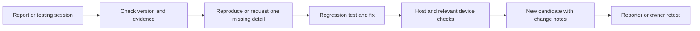

# Public testing and feedback

FMER is public before 1.0. The baseline is firmware **734-r2** and Companion
**734 r5**, released as `build-734-r5`. Test the parts you use; you do not need to
complete a checklist or submit feedback in every category.

## Send useful feedback

1. Start with the [current downloads](https://github.com/Nacsez/FMER/releases).
   Record the firmware build and the full Companion version from its footer.
2. Open [an issue](https://github.com/Nacsez/FMER/issues/new/choose). Choose
   **Bug report** for a reproducible problem, **Beta feedback** for a testing
   session, or **Workflow or feature suggestion** for an improvement.
3. Explain what you tried, what you expected, what happened and whether it repeats.
   For a bug, keep separate problems in separate issues when practical.
4. In Companion, open **Beta feedback**, enter any observations and select
   **Export feedback and diagnostic summary**. Review the local JSON, then attach
   it to the issue; ZIP it if necessary. Nothing uploads automatically.

The r5 export identifies the build as 734 but does not distinguish every
Companion revision. Please include the **r5** suffix from the footer yourself.
Improving that diagnostic detail is tracked for the next Companion update.

Useful context includes Windows version, initial firmware when installing,
USB/TRS connections, 1V/4V/4T mode, internal/external clock, and the page or action
in use. A short video can clarify timing or navigation. Do not attach ROM dumps,
entire AppData folders, private patch/project banks or credentials. Written
feedback and media can contain personal information even when the diagnostic
summary excludes device payloads and local paths.

Positive reports help too: say which workflow worked, which build you used and
roughly how long you tried it. Issue counts and download counts are not equivalent
to a tested-device count. Keep native backups before changing firmware.

## Suggested testing sessions

| Session | Try | Useful observations |
|---|---|---|
| First use | Extract ZIP, launch, connect, inspect/install, close and reopen | Starting firmware, progress/errors, successful final identity, stale connection state |
| Sound design | Browse FM/VA/USER, switch modes, edit envelopes/FX and save | Parameter response, unexpected mode changes, patch recall |
| Arrangement | Record notes/arp, edit rests/ties, chain patterns, use Song | Count-in alignment, held notes, transitions, saved project recall |
| Performance | Mixer layers, queued launches, shortcuts and waveform views | Readability, response, sound continuity and reproducible overload cases |
| MIDI | DAW or a direct USB peer; notes, clock, channels and reconnect | Exact topology, who supplies clock, duplicates, drift or stuck notes |
| Standalone | Normal battery use, save/reload and restart | Approximate elapsed time, displayed percentage and power symptoms |
| Companion library | Rename, organize, deploy, backup/restore | Destination clarity, preserved data and useful failure recovery |

Do not deliberately risk important musical data or force unsupported firmware
layouts. Bluetooth is not in the current release. It has a separate
[engineering plan](BLUETOOTH_PLAN.md).

## How feedback becomes a fix

The maintainer controls official changes. Outside code contributions need prior
permission; issues are the feedback channel. This policy does not limit GPL rights.
No automatic replies, log uploads or publishing jobs are enabled.

## Maintainer triage procedure

Review new reports regularly during active testing; a suggested cadence is two
reviews per week plus immediate attention to installation or data-loss reports.
This is a working cadence, not a promised response-time service.

- Retain the original report and its build/setup; record a duplicate's issue
  number instead of discarding independent evidence. Use one primary issue per fix.
- Assign an area and one state: `triage`, `needs-info`, `confirmed`,
  `ready-to-retest`, or `verified`. Use `blocked` for a documented dependency.
  A closed issue should state whether it was fixed, duplicated, declined or could
  not be reproduced; do not turn lack of reproduction into a claimed pass.
- P0: installation/recovery failure risking a usable unit, data loss or a severe
  safety concern. Stop promotion of the affected candidate and investigate.
  P1: core musical workflow broken with no reasonable workaround. P2: a defect
  with a workaround. P3: polish or an optional enhancement. Severity describes
  impact; it is not set by popularity alone.
- Keep human observations separate from measured counters. An offline session
  may lack a complete trace; retained counters or the latest event window do not
  reconstruct everything that happened. Ask for a short reproduction before
  requesting another large log dump.
- Store raw attachments in ignored local evidence with receipt time and SHA-256.
  Never execute submitted scripts or upload raw logs automatically. Public records
  should contain only a reviewed summary and the minimal reproduction.
- For a confirmed failure, add an observable regression, implement the smallest
  effective fix and record exact before/after builds. Test preservation and error
  paths as well as the successful path. UI documentation changes need link/render
  checks; hardware conclusions need device evidence.
- Candidate notes should list fixed issues, known limitations, exact files/hashes
  and requested retests. Close the loop with reporter/owner acceptance when
  available; record automated-only verification honestly when it is not.

Keep published tags/assets immutable. Future fixes get a new firmware build or
Companion revision and a new candidate tag; use the existing 700-series system.
Bluetooth experiments must not replace the public baseline downloads.
