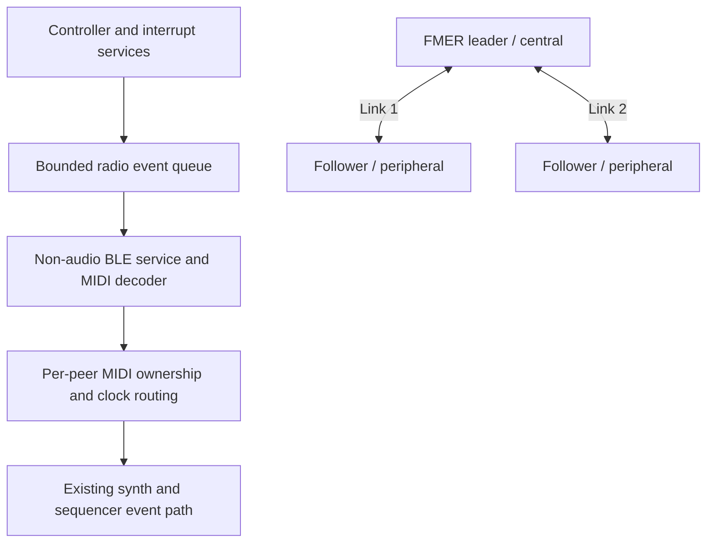

# Bluetooth MIDI: post-release engineering plan

21 October 2026. **Research GO; release inclusion remains NO-GO until qualified.**
The owner has resumed planning after the first public release. Current firmware
734-r2 has no active Bluetooth radio backend. No firmware or unit is changed by
this preparation. The portable transport is useful existing work, not a radio.

## What is established

The existing `core/ble_midi.*` implements bounded short-message encoding,
timestamps, queues, clock authority and simulated peer ownership. Its host test
passes again. A fresh retained transport link against the released source-runtime
734-r2 candidate succeeds, without vendor radio code or a flashable package:

| Region | Baseline | Transport retained | Meaning |
|---|---:|---:|---|
| Application | 214,720 B | 217,796 B | +3,076 B; full radio flash cost unknown |
| Static RAM span | 84,588 B | 86,688 B | +2,100 B; 11,616 B remains in this region |
| Fixed workspace | 44,272 B | 44,272 B | No transport increase |

The startup arena previously had about 68,432 B remaining; that is historical
bench evidence, not a new radio-on measurement. Connection/controller buffers,
task stacks and allocation peaks are not covered by these numbers. Spare flash
cannot replace mutable RAM. Do not assume a second usable core or overclock.

The earlier audit identified a missing `os_taskq_post_type`, startup alignment,
undefined controller-section placement, and a task/interrupt runtime mismatch.
It was a partial dependency link, not the full radio implementation. This pass
does not claim those blockers were fixed or repeat that partial link as progress.
`firmware/fm1/runtime.cpp` still has a startup-only allocator and no-op `free()`.
Radio reconnects cannot safely use that allocation policy without an audit.

## Architecture and sequence

| Gate | Work | Evidence required before advancing |
|---|---|---|
| B0: runtime contract | Inventory actual linked controller/host objects, source/license scope, task/timer/IRQ services and linker sections. Choose a bounded adapter or explicitly review a larger runtime port. | Complete dependency matrix; legitimate OS services; reproducible link/boot plan; no unresolved-symbol or no-op scheduler workaround |
| B1: memory ownership | Isolate reusable radio storage from audio/startup objects; define allocation limits, cleanup, queue policy and stack guards. | Failure injection, exhaustion/reconnect cleanup, measured complete-stack memory; no allocation/logging/locks in audio |
| B2: one radio link | Start peripheral advertising, actual GATT discovery/subscription, bidirectional notes/controls and disconnect release; then implement central scanning/connection. | Physical service-ready link, MIDI application rather than LEDs alone, clean disable/recovery; exact peer and firmware identities |
| B3: musical integration | Extend board source admission and all source-owned state for BLE peers6-8: notes, sustain, bend, bank/program, channel-mode messages, clock and disconnect. | Board regressions proving one peer cannot release/change another peer's held state; no duplicated forwarded clocks/notes |
| B4: loaded pair | Compare radio off/on while playing four voices/tracks, FX, Song/arp, displays, controls and USB audio. | Timing/stack/allocator/queue counters, no capability reduction, audible/recorded comparison, reconnect and low-power behavior |
| B5: three instruments | One central with two independently routed peripheral peers, one musical clock authority. | Two-hour loaded run and100 physical reconnect cycles as initial targets; latency/jitter/drift, interference and battery evidence |
| B6: release admission | Recovery, save/reload, Companion, UI/help and source/provenance audit. | Owner acceptance of exact candidate and documented compatibility limits |

B0 is the next engineering task. Do not start by adding a pairing menu or merely
providing the missing symbol. The vendor runtime expects real services. If its
architecture cannot coexist with the existing audio/USB/display ownership, stop
and cost a deliberate board-runtime port before proceeding.

Initial memory review targets remain: at most48 KiB additional startup-arena
use, at least16 KiB arena reserve and8 KiB static reserve, with existing guarded
stacks/workspace preserved. These are provisional budgets, not measured radio
requirements. The transport leaves only3,424 B static above that reserve before
radio integration. Any repartition needs an explicit map and regression review.

Use the existing2,176 microsecond audio reserve target, about75% of the2,902
microsecond block deadline. Older prose saying80% alongside2,176 was inconsistent;
use the explicit target for comparison. Establish wireless timing tolerances
from a measured wired baseline and listening before calling group sync
performance-ready. Record p50/p95/p99/max latency, clock skew/drift, connection
interval, losses, queue peaks and reconnect recovery; averages alone are inadequate.

## Initial product boundary

Aim first for one peer, then three total FMER instruments. Central/peripheral is
a radio role; clock source/follower is a musical role and must be explicit.
Receive/transmit notes, controllers, bank/program, pitch bend and real-time
transport, with exactly one clock authority and deliberate routes. Never echo
incoming traffic to every transport automatically. On disconnect, release that
peer's owned notes/sustain without silencing physical keys or other peers.

No Bluetooth audio, firmware flashing, Companion backups, automatic mesh/leader
election or SysEx is promised by the initial profile. Current portable decoding
explicitly excludes SysEx and continuation packets. A fourth instrument is a
later capacity test, not an assumption based on an array size of three peers.
Names alone are not stable peer identity. Pairing/security storage must stay
separate from musical projects and survive a reviewed reset workflow.

## References and evidence scope

The [JieLi AC79 BLE demo documentation](https://doc.zh-jieli.com/AC79/zh-cn/release_v1.0.3/project_template/demo/demo_ble.html),
checked21 October, describes central/peripheral and multi-link configurations.
This supports investigating a star topology, but establishes neither FM-1 runtime
compatibility nor our usable RAM, RF link count or timing. The
[MIDI Association BLE-MIDI overview](https://midi.org/midi-over-bluetooth-low-energy-ble-midi)
describes standardized encoding; it is not FMER interoperability qualification.
No new SDK or dependency is integrated in this planning pass.

Workspace records: `docs/BLUETOOTH_RELEASE_DECISION_2026-10-19.md`,
`docs/BLUETOOTH_RESUME.md`, and
`artifacts/beta-readiness-20261021/ble-transport-r2/report.json`.
The historical full audit/raw artifacts remain local. This public plan summarizes
their scope without distributing vendor archives or device metadata.
